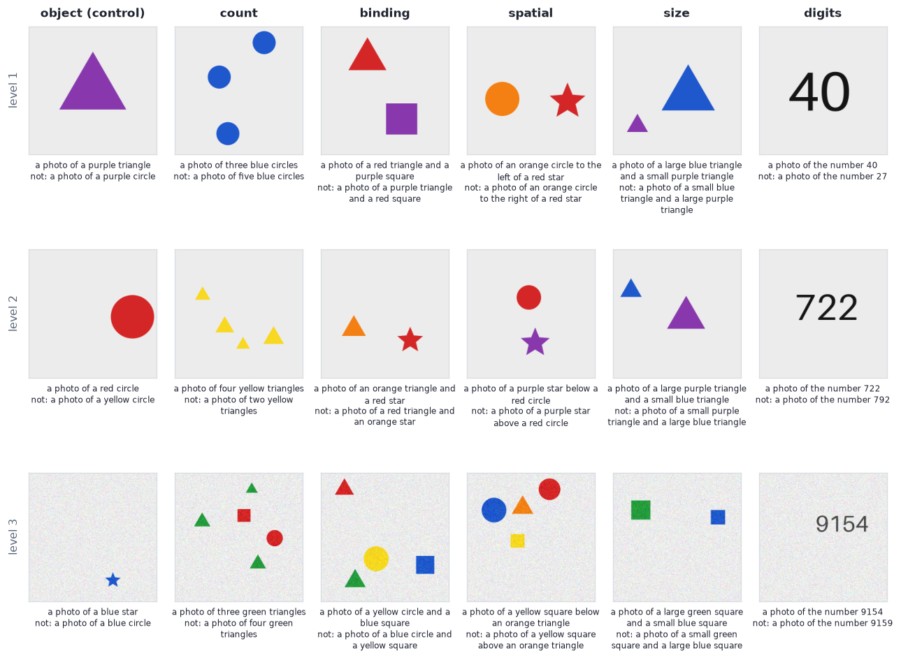
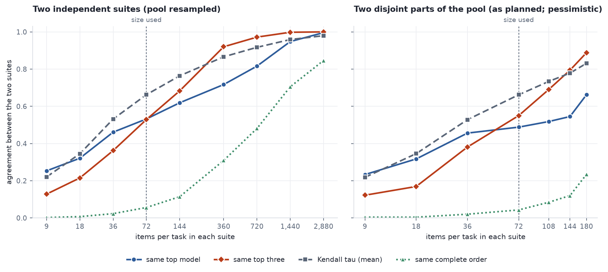
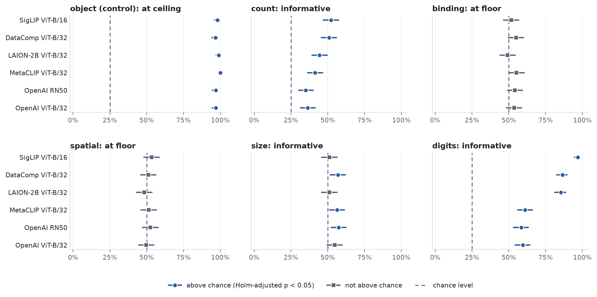

# Procedural-Multimodal_benchmark-reliability-suite

**If a benchmark is regenerated from a seed instead of being kept fixed, can it still be
trusted to rank models?**

A fixed test set leaks into training data and saturates. This project builds an image and
audio benchmark whose items are generated from a seed, with exact ground truth and a
difficulty knob, so a fresh test set can be produced on demand. It then does what is
usually skipped: it measures the benchmark itself. Nine public models (CLIP from four
training sources, SigLIP, and three CLAP audio models) are run through one pipeline, and
seven reliability checks say whether the resulting ranking deserves to be believed.



## What was found

Six image-text models and three audio-text models were scored zero-shot on a laptop CPU:
2,160 image items in five regenerated suites, and 360 audio clips in three. The full
write-up is in [REPORT.md](REPORT.md). The plan, written before any model was scored, is
in [PLAN.md](PLAN.md).

| Model | Overall score | 95% interval | Rank interval | count | digits |
|---|---|---|---|---|---|
| SigLIP ViT-B/16 | 67.2% | 65.5 to 69.0 | 1 to 2 | 52% | 97% |
| DataComp ViT-B/32 | 66.2% | 64.3 to 68.0 | 1 to 2 | 51% | 86% |
| LAION-2B ViT-B/32 | 62.9% | 61.0 to 64.6 | 3 to 4 | 44% | 85% |
| MetaCLIP ViT-B/32 | 60.9% | 59.0 to 62.8 | 3 to 5 | 41% | 61% |
| OpenAI RN50 | 59.1% | 57.1 to 61.1 | 4 to 6 | 35% | 58% |
| OpenAI ViT-B/32 | 58.5% | 56.4 to 60.4 | 4 to 6 | 36% | 59% |

The overall score is the mean accuracy over six tasks. The scores matter less than what
the checks say about them:

| Check | Result on the image suite | Verdict |
|---|---|---|
| Ranking stability | 10 of 15 model pairs separated on 2,160 items; 5 of 15 on one suite of 432 | caution |
| Suite size | two independent suites of 72 items per task agree on the top model 53% of the time, on the complete order 6% | problem |
| Regeneration | scores vary across seeds by 1.68 points (SD), sampling predicts 2.13; 2 of 35 model-task cells differ between seeds, as chance would give | sound, but see suite size |
| Wording | rewording moves a score by 2.7 points on average, more than the 1.85-point median gap between neighbours; no change could be told from noise | caution |
| Floor and ceiling | `binding` and `spatial` at floor for all six models, `object` at ceiling | problem |
| Item quality | 103 items answered by no model and 562 by all, of 2,160; 322 run against ability, 367 would by chance | caution |
| Redundancy | `count` and `digits` order the models identically | caution |

- **A regenerated suite is a valid replacement for the one before it.** Across seeds,
  scores move as sampling noise predicts and no more.
- **But the suite I generated is too small to rank these models.** The two best are one
  point apart, and resampling suggests about 1,440 items per task are needed to name the
  same top model 95% of the time. One suite's own bootstrap was 97% sure of a top model
  that led in only two of five suites.
- **Half the image tasks cannot rank anything**, and the ranking that remains is largely
  a ranking of how well the models read rendered digits.
- **I predicted wording would matter more than regeneration. It did not.** Both were
  within sampling noise at this size.
- Of nine hypotheses, four were supported, four partly and one failed. The audio suite
  runs through the same pipeline but, with three models and 90 clips per task, supports
  no ranking: two of its four tasks are at floor.





The health report for this run is one self-contained HTML file:
[docs/health_report.html](docs/health_report.html).

These are small contrastive models matching captions to synthetic shapes and tones. That
such models are weak at counting, binding and spatial relations is well known and is not
a finding of this project. Nothing here says how generative multimodal models would
score.

## What is in the repository

| Part | File | What it does |
|---|---|---|
| Items | `src/regenbench/items.py` | The item format, suite manifests with a checksum, the question/answer rendering |
| Rendering | `src/regenbench/render.py` | Scene to image (PIL) or to waveform (NumPy); a pure function of the scene |
| Image tasks | `src/regenbench/tasks_vision.py` | object, count, binding, spatial, size, digits; three levels, three caption templates |
| Audio tasks | `src/regenbench/tasks_audio.py` | bursts, pitch, order, tempo |
| Generation | `src/regenbench/generate.py` | A suite from a seed; every item has its own random stream |
| Adapters | `src/regenbench/adapters/` | The `score(media, candidate_texts)` interface; open_clip and CLAP adapters; a chance-level fake |
| Pipeline | `src/regenbench/evaluate.py` | Chunked, cached, resumable evaluation that stores raw item-level scores |
| Statistics | `src/regenbench/stats.py` | Bootstrap, Wilson, exact binomial and McNemar, Holm, Kendall, Spearman, KR-20, written from NumPy |
| Reliability | `src/regenbench/reliability.py` | The seven checks |
| Hypotheses | `src/regenbench/hypotheses.py` | The decision rules of PLAN.md as code, committed before the runs |
| Summary | `src/regenbench/summarise.py` | Result files to `results/summary.json` |
| Figures | `src/regenbench/figures.py` | Every figure in this README and the report |
| Health report | `src/regenbench/report.py` | A self-contained HTML report with a verdict per check |
| Study design | `src/regenbench/study.py`, `src/regenbench/models.py` | Suites, seeds, sizes and exact checkpoints |
| Results | `results/` | Item-level scores of every model, the summary, tidy tables |
| Tests | `tests/` | 113 tests: ground truth of every task, statistics against known values, the pipeline with fake models |

## Generate a fresh test set

```bash
uv run regenbench generate --modality vision --seed 2026 --n-per-task 30 --suite-id fresh
```

This writes `data/fresh/items.jsonl` (180 items: six tasks, three levels, three caption
templates) and `data/fresh/suite.json` with the checksum. Add `--write-media` to also
write the PNG files. Any other seed gives a different test set from the same
distribution; `--modality audio` gives audio clips. Each line of the manifest holds the
scene, the candidate captions, the index of the true one, and a plain question with
lettered answers for generative models.

## Add your own model in 15 lines

A model needs one method. This wraps the Hugging Face `transformers` CLIP, which is not
one of the built-in adapters ([examples/my_adapter.py](examples/my_adapter.py)):

```python
import torch
from transformers import CLIPModel, CLIPProcessor
from regenbench.adapters import Adapter

class HFClip(Adapter):
    name = "hf-clip-vit-b32"  # used in result file names
    modality = "image"  # or "audio"
    identifier = "openai/clip-vit-base-patch32"

    def __init__(self):
        self.model = CLIPModel.from_pretrained(self.identifier).eval()
        self.processor = CLIPProcessor.from_pretrained(self.identifier)

    def score(self, media, candidate_texts):
        inputs = self.processor(text=list(candidate_texts), images=media, return_tensors="pt", padding=True)
        with torch.no_grad():
            return self.model(**inputs).logits_per_image[0].numpy()
```

Then hand it to the pipeline:

```python
from pathlib import Path
from regenbench.evaluate import evaluate_suite, load_result

out = evaluate_suite(HFClip(), Path("data/fresh"), Path("results"), run_id="example")
print(load_result(out)["correct"].mean(axis=0))  # accuracy under each caption template
```

I ran this on the fresh suite above (180 items, 80 seconds of model time): accuracy was
56.1%, 58.3% and 54.4% under the three templates. As a check on the pipeline I also ran
it on the seed-0 study suite. It shares weights, but no code, with the `open_clip`
checkpoint used in the study, and the two agreed on all 1,296 item outcomes.

## Reproduce it

You need Python 3.11 or newer and [uv](https://docs.astral.sh/uv/). No GPU is used.

```bash
git clone https://github.com/AmosBunde/Procedural-Multimodal_benchmark-reliability-suite
cd Procedural-Multimodal_benchmark-reliability-suite
uv sync --extra dev          # CPU PyTorch, open_clip, transformers
uv run pytest -q             # 113 tests, about a minute
```

Then, in order:

| Step | Command | Time | Writes |
|---|---|---|---|
| 1. Generate the suites | `uv run regenbench generate --study` | 1 second | `data/` (eight manifests, 2.2 MB, not in git) |
| 2. Check one model | `uv run regenbench evaluate --suite data/vision-seed0 --models openai-vit-b32 --run-id check` | 1 to 2 minutes, after a 0.58 GB download | `results/runs/check/` |
| 3. Run every model | `uv run regenbench evaluate --study` | 84 minutes on my laptop, after 7.7 GB of downloads | `results/runs/main/` (39 files) |
| 4. Analyse | `uv run regenbench summarise` | 15 seconds | `results/summary.json`, two parquet tables |
| 5. Draw the figures | `uv run regenbench figures` | 5 seconds | `docs/img/` |
| 6. Build the health report | `uv run regenbench report` | 1 second | `docs/health_report.html` |

Step 2 should print an overall accuracy of 0.590 under the canonical wording. Step 3
downloads 3.5 GB for the six image models and 4.2 GB for the three audio models into the
Hugging Face cache. It skips any result file that already exists and resumes an
interrupted model from `.cache/`, so it can be stopped and restarted. Of the 84 minutes,
68 were the image models and 14 the audio models; SigLIP alone took 37, and the laptop
was throttling. The result files from my run are committed, so steps 4 to 6 work
straight after cloning.

Item generation is deterministic: step 1 reproduces the checksums stored in
`results/summary.json`. On my machine, running step 2 again reproduced the scores of the
main run bit for bit. I have not tested another machine: model scores depend on
floating-point arithmetic, so an item with a near-tie between captions may flip there.
Expect accuracies within a fraction of a point of the committed ones.

## Reading the results yourself

- `results/summary.json`: every number quoted here and in the report.
- `results/runs/main/*.npz`: for each suite and model, the raw score of every candidate
  caption under every template, with task, level and answer for each item.
- `results/item_results.parquet`: one row per suite, item, template and model: right or
  wrong, and the margin of the true caption over the best wrong one.
- `results/item_statistics.parquet`: one row per item: share of models that got it right
  and its correlation with overall ability.
- [docs/health_report.html](docs/health_report.html): the health report for this run.
  Download it and open it in a browser; it makes no network requests.

`uv run python scripts/check_numbers.py` checks that every number in this README and in
the report can be found in the result files.

## Limits

- Zero-shot caption matching with contrastive models only. No generative multimodal
  model was evaluated; the question/answer format for them exists but is unused.
- Synthetic shapes and tones are out of distribution for these models. Low accuracy may
  reflect that and not a missing skill.
- Six image models, four of them ViT-B/32, and three audio models. Statistics that treat
  models as examinees (item analysis, task correlations) are noisy with so few.
- 360 items per image task and 90 clips per audio task. Models closer than about two
  points overall are not separated, and the audio results are a demonstration only.
- Caption paraphrases were evaluated on one of the five image suites.
- The plan was committed before the runs but not registered externally. One planned
  estimate turned out to be biased and two analyses were added afterwards; PLAN.md lists
  them as amendments.
- The evaluation took 84 minutes against a budget of about 60.

## Licence

MIT. See [LICENSE](LICENSE). The model checkpoints are not part of this repository and
carry their own licences, listed in the report.
