# Can a benchmark that is regenerated from a seed be trusted to rank models?

Amos Bunde, November 2026

## Summary

I built a benchmark of six image tasks and four audio tasks whose items are generated
from a seed, with exact ground truth, three difficulty levels and three caption wordings.
I ran six image-text models (CLIP from four training sources, and SigLIP) and three CLAP
audio-text models on it, zero-shot, on a laptop CPU: 2,160 image items in five
regenerated suites and 360 audio clips in three. Then I measured the benchmark.

- **Regeneration is sound, but one suite is too small.** Scores on regenerated suites
  vary as binomial sampling predicts and no more: the overall score moved by 1.68 points
  (standard deviation across seeds) where sampling alone predicts 2.13, and 2 of 35
  model-task cells differed between seeds at the 5% level, which is the chance rate. Yet
  a suite of 72 items per task does not fix the ranking. Two independent suites of that
  size name the same top model 53% of the time and the same complete order 6% of the
  time. The top model changed between suites: SigLIP in two, DataComp CLIP in three.
- **The pooled 2,160 items separate 10 of 15 model pairs.** One suite of 432 items
  separates 5. By resampling, agreeing on the top model 95% of the time needs about
  1,440 items per task, because the two best models differ by one point.
- **Half the image suite cannot rank anything.** `binding` and `spatial` are at floor: no
  model is above chance. `object` is at ceiling. `size` is barely above chance for three
  models. The ranking rests on `count` and `digits`, and those two order the six models
  identically.
- **Wording moves scores as much as the gaps between models, but not provably.**
  Rewording the captions moved a model's overall score by 2.7 points on average, more
  than the 1.85-point median gap between neighbouring models, and one paraphrase
  reordered the models almost at random (Kendall tau 0.14). But none of the 12 changes
  in overall score, and none of 72 per-task changes after correction, could be told from
  noise at this sample size. I predicted wording would matter more than regeneration.
  It did not.
- **Item statistics over six models are mostly noise.** 322 items ran against overall
  ability; 367 would by chance.
- **Audio.** `order` and `tempo` are at floor for all three CLAP models, and one model is
  below chance at counting beeps. Three models and 90 clips per task support no ranking.

Of nine hypotheses, four were supported, four partly, and one failed. Zero-shot caption
matching on synthetic shapes and tones is not how these models are normally used, and
the low scores say as much about that mismatch as about the models. The claim here is
about the instrument: a regenerable benchmark needs these checks before its ranking
means anything, and the checks are cheap.

## 1. Question

A fixed benchmark ages badly. Its items leak into training data, models are tuned against
it, and scores climb for reasons that have little to do with ability. One answer is a
benchmark that is not fixed: items are generated from a seed, so a new test set that
nobody has seen can be produced whenever one is wanted, and difficulty can be raised when
models catch up.

That only helps if the regenerated copy measures the same thing as the copy it replaces.
If two draws from the same generator rank models differently, or if the ranking depends on
how a caption happens to be worded, the benchmark is not an instrument yet. And a
generated task can fail quietly in a way a curated one rarely does: every model can sit at
chance, or at 100%, and the task still produces a number.

So the question here is about the benchmark and not about the models:

**Can a procedurally generated image and audio benchmark be trusted to rank models, and
what has to be measured to know?**

I built the benchmark, ran nine public models on it, and then examined the benchmark with
seven checks. The plan, with nine hypotheses and their decision rules, was committed
before any model was scored ([PLAN.md](PLAN.md)).

What is not new. That contrastive image-text models are poor at counting, at binding
attributes to objects and at spatial relations is well established on natural images
[2, 3]. Procedurally generated diagnostic benchmarks with exact ground truth go back at
least to CLEVR [4]. The statistics are classical [10-15]. Others have asked how many
items a benchmark needs and how far its rankings can be trusted [16-19]. The contribution
is a regenerable multimodal suite, a pipeline that runs several model lines through it,
and reliability tooling applied to the result, all small enough to rerun on a laptop.

## 2. The benchmark

### 2.1 Items

An item is one image or one audio clip with two or four candidate captions. Exactly one
caption is true. The item stores the scene it was rendered from: every object with its
shape, colour, position and size, or every sound event with its time, length and
frequency. Rendering is a pure function of the scene, so a suite is fully described by a
manifest of scenes, and the truth of every caption can be checked from the scene and again
from the rendered pixels or samples.

Each item draws from its own random stream, keyed by the suite seed, the task, the
difficulty level and an index. A suite with a new seed is a fresh draw from the same
generator. A manifest carries a SHA-256 checksum, and a result file records the checksum
of the suite it was computed on.

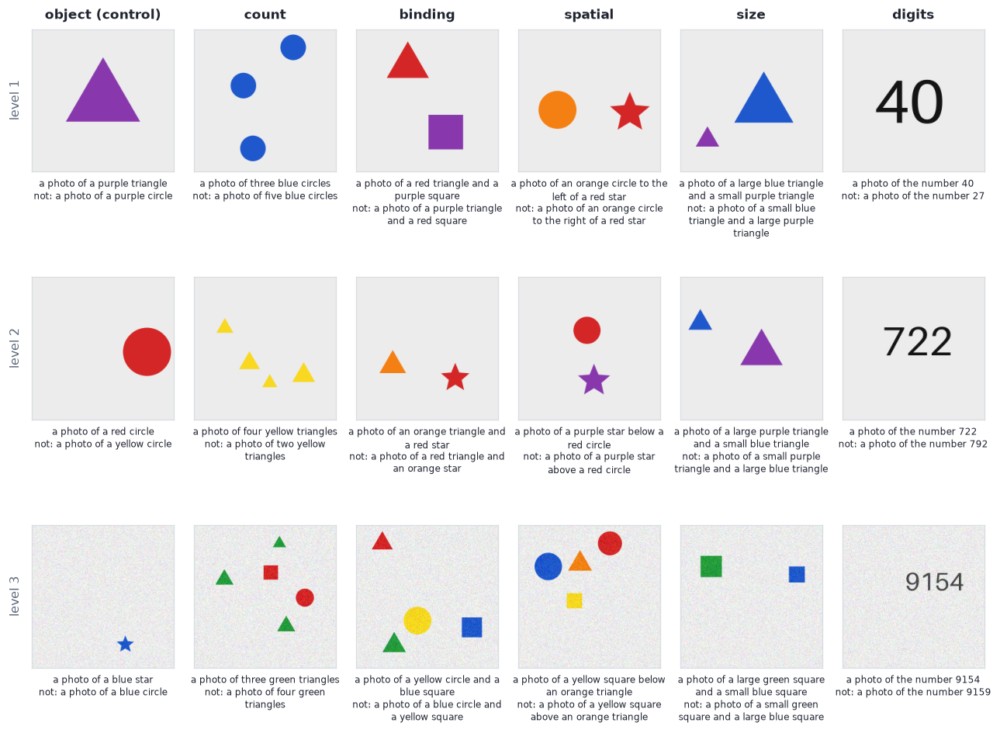

### 2.2 Image tasks

Images are 224 x 224 pixels: flat shapes (circle, square, triangle, star) in six colours
on a light grey ground, drawn with PIL at four times the resolution and averaged down.

| Task | Asks | Choices | Level 1 | Level 2 | Level 3 |
|---|---|---|---|---|---|
| object | colour and shape of one object | 4 | large, centred | medium, anywhere | small, pixel noise |
| count | how many shapes of one kind | 4 | 1 to 4, equal size | 2 to 7, mixed sizes | 3 to 9, distractors, noise |
| binding | which colour goes with which shape | 2 | two large objects | smaller | plus two distractors, noise |
| spatial | left of, right of, above, below | 2 | far apart, aligned | closer, slightly off-axis | closer still, distractors, noise |
| size | which of two like shapes is larger | 2 | ratio 2.0 to 2.6 | 1.5 to 1.8 | 1.25 to 1.4, noise |
| digits | read a number | 4 | 2 digits, unrelated foils | 3 digits, foils one digit off | 4 digits, small, low contrast, noise |

The foils are chosen so that shortcuts do not work. The wrong caption in `binding` swaps
the two colours and so contains exactly the same words as the true one. The wrong caption
in `spatial` states the opposite relation. Count options are four consecutive numbers that
include the true one. Distractor objects never share a colour or a shape with a tested
object, so they cannot make a foil true. Shapes never touch or overlap. The position of
the true caption is shuffled.

`object` is a control. It asks for nothing compositional and should be easy.

### 2.3 Audio tasks

Clips are ten seconds at 48 kHz, synthesised with NumPy from sine tones, bursts of white
noise and short clicks. Ten seconds is the window the CLAP models take, so a clip reaches
the model without padding or repetition.

| Task | Asks | Choices | What the levels change |
|---|---|---|---|
| bursts | how many beeps | 4 | 1 to 4 long beeps; 2 to 7 shorter; 3 to 9 short beeps in noise |
| pitch | does a tone rise or fall | 2 | a sweep of two octaves; a smaller sweep; a sweep of 15 to 30% in noise |
| order | beep then noise, or noise then beep | 2 | long events; shorter; very short, in noise |
| tempo | do clicks speed up or slow down | 2 | a large change in spacing; a moderate one; a small one, in noise |

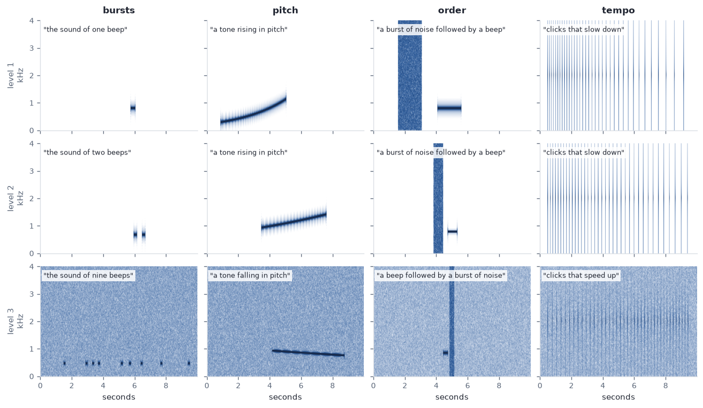

### 2.4 Caption templates and the question format

Every task has three caption templates. The first is the canonical wording ("a photo of
three red circles"). The other two are paraphrases ("an image containing exactly three
red circles", "a picture showing 3 red circles"). For `spatial` and `size` the third
template states the same fact from the other object's side ("a blue circle to the right
of a red square" for "a red square to the left of a blue circle").

Each item also carries a question and short answers ("How many red circles are in the
image? A. two B. three ..."), so a generative model can be asked directly. No generative
model is evaluated in this study.

### 2.5 Checking the ground truth

The test suite checks the answer of every generated item twice, once from the scene and
once from the rendered media: shapes are counted back as connected regions of the target
colour, the spatial relation is recomputed from coordinates and must dominate the other
axis by at least three to one, relative size is checked against rendered area, each digit
foil must render a visibly different image, beeps are counted from the envelope of the
waveform, pitch direction is read from the spectrum, event order from zero-crossing
rates, and tempo from click spacing.

## 3. The pipeline

A model takes part by implementing one method, `score(media, candidate_texts)`, which
returns one number per caption. An item is correct if the true caption scores strictly
highest; ties are wrong. Two adapters are provided: one for image-text models loaded
through `open_clip`, one for audio-text models loaded through `transformers`.

The pipeline renders each item, asks the adapter for the scores of every caption under
every template, and stores the raw scores. Items are processed in chunks that are written
to a cache as they finish, so an interrupted run resumes where it stopped. The cache is
keyed on the suite checksum, the model and the chunk size and is dropped when any of
them changes.

Nine public checkpoints were evaluated, downloaded anonymously from Hugging Face. The
licence column is the tag on each model card on 20 November 2026; I have not checked it
against the original releases.

| Key | Checkpoint | Revision | Architecture | Training data | Licence tag | Download |
|---|---|---|---|---|---|---|
| openai-rn50 | `timm/resnet50_clip.openai` | `ec3d92cf63` | ResNet-50 CLIP [1] | OpenAI, 400M pairs | mit | 0.39 GB |
| openai-vit-b32 | `timm/vit_base_patch32_clip_224.openai` | `a6f597a30f` | ViT-B/32 CLIP [1] | OpenAI, 400M pairs | apache-2.0 | 0.58 GB |
| laion2b-vit-b32 | `laion/CLIP-ViT-B-32-laion2B-s34B-b79K` | `1a25a44671` | ViT-B/32 CLIP | LAION-2B [6] | mit | 0.58 GB |
| datacomp-vit-b32 | `laion/CLIP-ViT-B-32-DataComp.XL-s13B-b90K` | `f0e2ffa09c` | ViT-B/32 CLIP | DataComp-1B [7] | mit | 0.58 GB |
| metaclip-vit-b32 | `timm/vit_base_patch32_clip_224.metaclip_400m` | `52dc0f732e` | ViT-B/32 CLIP | MetaCLIP 400M [8] | cc-by-nc-4.0 | 0.58 GB |
| siglip-vit-b16 | `timm/ViT-B-16-SigLIP` | `41f575766f` | ViT-B/16, sigmoid loss [5] | WebLI | apache-2.0 | 0.78 GB |
| clap-htsat-unfused | `laion/clap-htsat-unfused` | `8fa0f1c6d0` | HTSAT + RoBERTa CLAP [9] | see model card | apache-2.0 | 1.2 GB |
| clap-larger-general | `laion/larger_clap_general` | `ada0c23a36` | larger CLAP [9] | see model card | apache-2.0 | 1.5 GB |
| clap-larger-music-speech | `laion/larger_clap_music_and_speech` | `195c3a3e68` | larger CLAP [9] | see model card | apache-2.0 | 1.5 GB |

Four of the six image models are ViT-B/32. That was forced by the machine: the timing
pilots showed that ViT-B/16 and ViT-L/14 CLIP models would not fit the time I had, and I
kept SigLIP ViT-B/16 as the one model from outside the CLIP family.

**The sample.** Five image suites from seeds 0 to 4, each with 72 items per task (24 per
level): 432 items per suite, 2,160 in all, 360 per task. Seed 0 carries three caption
templates and seeds 1 to 4 the canonical one. Three audio suites from seeds 0 to 2, each
with 30 clips per task: 120 per suite, 360 in all, 90 per task, all with three
templates. The full run produced 39 result files and took 84 minutes of wall time, against
a budget of about 60: the laptop throttled, another job started on it part-way, and
SigLIP alone took 37 minutes.

**A cross-check of the pipeline.** The adapter example in the README wraps the
`transformers` implementation of OpenAI CLIP ViT-B/32, which shares weights with the
`open_clip` checkpoint used in the study but not code. On the seed-0 suite the two
agreed on all 1,296 item outcomes (432 items under three templates). That also checks
the text-encoding shortcut described next, which only the `open_clip` adapter uses.

On a CPU the CLIP text tower is the slow step, because it always processes 77 token
positions and these captions use fewer than 25. For models with a causal text tower the
positions after the end-of-text token cannot affect the embedding, so the adapter skips
them. It checks at load time that the short and full encodings agree and falls back to
the full length if they do not. SigLIP's text tower is not causal and always runs in full.

## 4. Reliability methods

The overall score of a model is the unweighted mean of its task accuracies under the
canonical template. "Pooled" means all suites of a modality together.

**Ranking stability.** A stratified bootstrap over items [12]: items are resampled within
each task, and the same resample is applied to every model, which keeps comparisons
paired. From 2,000 resamples I take 95% percentile intervals on each score, on each rank
and on each pairwise difference. A pair is "separated" when the interval of its difference
excludes zero. Exact McNemar tests [15] with Holm correction [14] are reported beside it.

**Items needed.** For a size n, draw two disjoint random sets of n items per task from the
pool and compare the rankings they give: Kendall tau [13], whether the top model is the
same, whether the top three are the same, and whether the complete order is the same,
over 1,000 draws. This is what two people would see if each generated their own suite of
that size. The more common check, comparing a subset with the full set that contains it,
is reported too; it is optimistic and reaches perfect agreement by construction.

**Seed reproducibility.** Each model is scored on every regenerated suite. I report the
standard deviation of its overall score across seeds beside what binomial sampling alone
predicts, Kendall tau between the rankings of each pair of suites, and, for each
model-task cell, a chi-square test that the accuracy is the same in every seed. Items
from different seeds are independent draws from one generator, so about 5% of cells
should be rejected at the 5% level. Many more than that would mean the generator, or the
pipeline, is not doing what it claims.

**Template sensitivity.** On the seed-0 suite every model is scored under each of the
three templates on the same items. I report the spread of the overall score across
templates, rank agreement between templates, the share of items whose outcome depends on
the wording, and a paired bootstrap interval for each change from the canonical wording.

**Item analysis.** With models in the role of examinees: the share of models that answer
each item correctly, and the correlation between answering it correctly and the model's
overall score. Items no model gets right and items every model gets right cannot
separate anyone. Items with a correlation of -0.4 or below run against ability. With six
examinees that correlation is very noisy, so the count of such items is compared with an
exact null: for an item that k models got right, every way of choosing k models is
listed, and the share of those choices that would give a correlation that low is the
chance rate. KR-20 [10] and split-half reliability are computed per task. I did not fit
an item response model; six examinees cannot support one.

**Floor and ceiling.** A model is above chance on a task if an exact one-sided binomial
test against the task's chance level gives p < 0.05 after Holm correction over models. A
task is at floor if no model is above chance, at ceiling if every model scores 95% or
more, and informative otherwise. Accuracies carry Wilson intervals [11].

**Redundancy.** Spearman correlation between tasks of the models' accuracies, with
bootstrap intervals over items, and the change in the overall ranking when each task is
left out.

Every statistic is implemented in `src/regenbench/stats.py` from NumPy primitives and
tested against hand-worked values and SciPy. The analyses are tested on simulated
outcomes with known answers, including a "regenerated" suite that is secretly harder and
a wording that breaks one model. `summarise` is deterministic.

## 5. Results

All image results use 2,160 items (360 per task) unless a single suite is named. Accuracy
is in per cent, differences in percentage points.

### 5.1 Scores

| Model | Overall | 95% interval | Rank | object | count | binding | spatial | size | digits |
|---|---|---|---|---|---|---|---|---|---|
| SigLIP ViT-B/16 | 67.2 | 65.5 to 69.0 | 1 to 2 | 98 | 52 | 52 | 53 | 51 | 97 |
| DataComp ViT-B/32 | 66.2 | 64.3 to 68.0 | 1 to 2 | 97 | 51 | 55 | 51 | 57 | 86 |
| LAION-2B ViT-B/32 | 62.9 | 61.0 to 64.6 | 3 to 4 | 99 | 44 | 49 | 48 | 51 | 85 |
| MetaCLIP ViT-B/32 | 60.9 | 59.0 to 62.8 | 3 to 5 | 100 | 41 | 55 | 51 | 56 | 61 |
| OpenAI RN50 | 59.1 | 57.1 to 61.1 | 4 to 6 | 97 | 35 | 54 | 52 | 57 | 58 |
| OpenAI ViT-B/32 | 58.5 | 56.4 to 60.4 | 4 to 6 | 97 | 36 | 54 | 50 | 55 | 59 |

Chance is 25% for `object`, `count` and `digits` and 50% for `binding`, `spatial` and
`size`. The pattern is the familiar one [2, 3]: these models name a single object, read
digits to varying degrees, count poorly, and do not bind or locate.

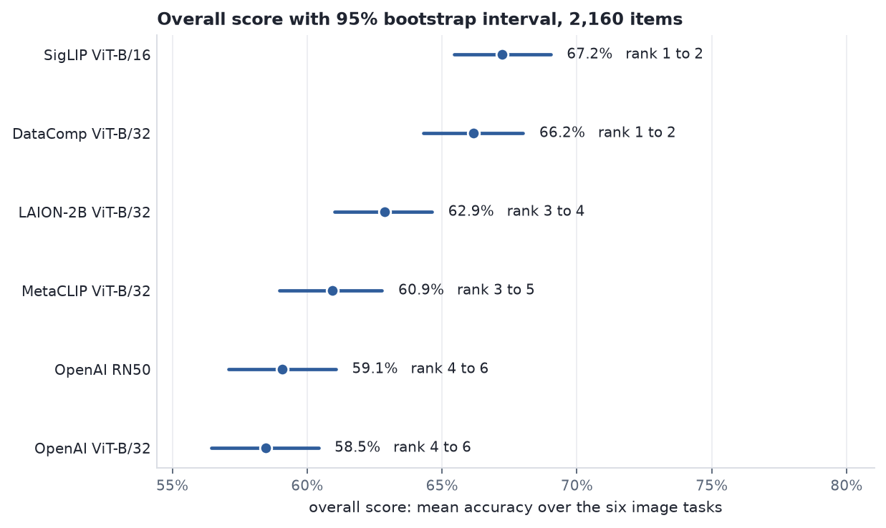

### 5.2 Ranking stability

Ten of the 15 model pairs are separated by the paired bootstrap, and the same ten by
McNemar tests after Holm correction. The five that are not are neighbours in the ranking:
SigLIP and DataComp at the top (1.06 points apart, interval -1.11 to 3.24), and the pairs
among MetaCLIP, RN50 and OpenAI ViT-B/32 and between LAION-2B and MetaCLIP. So the
benchmark supports a top pair and a rough order below it, not six ranks. The top model
stays on top in 84% of bootstrap resamples and the complete order survives in 49%.

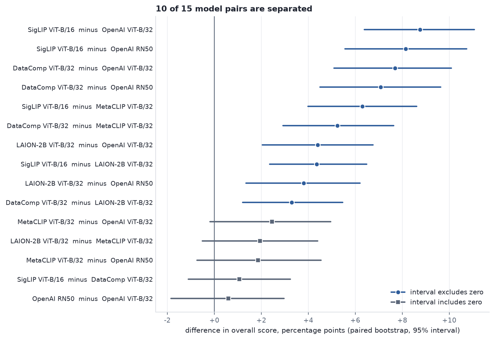

On the seed-0 suite alone (432 items) only 5 of 15 pairs are separated. That suite also
shows why one draw should not be trusted: its bootstrap puts SigLIP first in 97% of
resamples, yet SigLIP was first in only two of the five suites. Seed 0 happened to be
DataComp's worst draw. A bootstrap describes the items in hand; it cannot know they were
a lucky set.

### 5.3 Regenerated suites (H1: partly supported)

| Model | Five seeds, canonical wording | SD | SD expected | Three wordings, seed 0 | SD | Range | Items that flip |
|---|---|---|---|---|---|---|---|
| SigLIP ViT-B/16 | 68.5, 65.5, 65.7, 68.1, 68.3 | 1.47 | 2.01 | 68.5, 64.4, 68.8 | 2.48 | 4.4 | 45 |
| DataComp ViT-B/32 | 62.7, 67.4, 66.0, 66.0, 68.8 | 2.23 | 2.10 | 62.7, 65.0, 63.2 | 1.22 | 2.3 | 43 |
| LAION-2B ViT-B/32 | 62.0, 62.0, 62.3, 63.4, 64.6 | 1.12 | 2.09 | 62.0, 65.0, 63.2 | 1.52 | 3.0 | 43 |
| MetaCLIP ViT-B/32 | 59.3, 60.4, 59.5, 61.3, 64.1 | 1.97 | 2.17 | 59.3, 59.7, 59.7 | 0.27 | 0.5 | 53 |
| OpenAI RN50 | 62.3, 60.0, 57.6, 55.6, 60.0 | 2.56 | 2.19 | 62.3, 59.5, 59.3 | 1.67 | 3.0 | 50 |
| OpenAI ViT-B/32 | 59.0, 57.4, 58.1, 59.3, 58.6 | 0.74 | 2.19 | 59.0, 60.6, 57.6 | 1.51 | 3.0 | 50 |

"SD expected" is what binomial sampling of 72 items per task predicts. "Items that flip"
is the share of items whose outcome differs between wordings.

The three parts of H1:

- *Rank agreement.* Mean Kendall tau between the rankings of two suites is 0.73 (lowest
  pair 0.47). The threshold was 0.70. Held.
- *Same top model in at least four of five suites.* SigLIP was top in two suites and
  DataComp in three. Failed.
- *Consistency with sampling.* Of 35 testable model-task cells, 2 were rejected by the
  homogeneity test at the 5% level; chance predicts about two. The observed variance
  across seeds is 0.79 times the binomial variance. Held.

The third part is the one that matters for the design. A regenerated suite behaves like
a fresh sample from the same population: nothing drifts between seeds beyond sampling
noise. By construction that had to be true if the generator and the pipeline were
correct, so this is a check on both, and they pass. The second part says the suites are
too small to settle a one-point gap, which the next section quantifies.

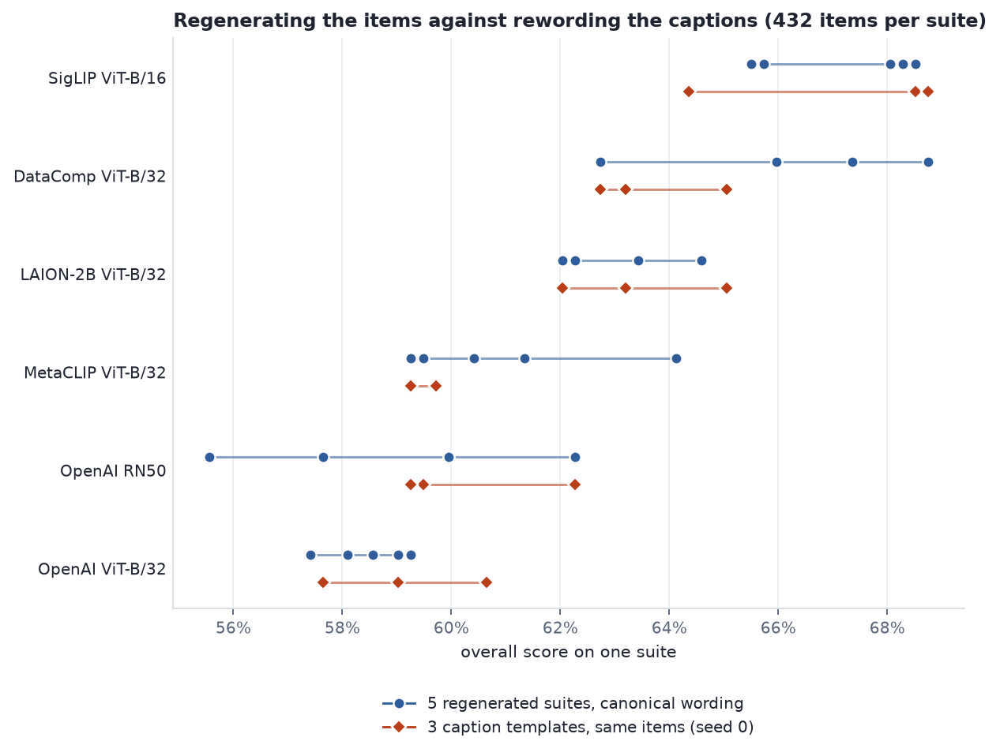

### 5.4 How many items are enough (H6: partly supported)

Scored as planned, on two disjoint parts of the pool: at 72 items per task two suites
agree on the top model in 49% of draws and on the top three in 55%. I had predicted at
least 90% and 80%. Both failed. At 180 items per task they agree on the complete order in
23% of draws; I had predicted under 50%, which held.

The planned estimate turned out to be biased (PLAN.md, amendment A1). Two disjoint parts
of a finite pool are negatively correlated, so they disagree more often than two
independent suites would. The corrected estimate draws both suites independently, with
replacement, from the pool:

| Items per task | Kendall tau | Same top model | Same top three | Same complete order |
|---|---|---|---|---|
| 9 | 0.22 | 25 | 13 | 0 |
| 18 | 0.34 | 32 | 22 | 1 |
| 36 | 0.53 | 46 | 36 | 2 |
| 72 | 0.66 | 53 | 53 | 6 |
| 144 | 0.76 | 62 | 68 | 11 |
| 360 | 0.87 | 72 | 92 | 31 |
| 720 | 0.92 | 82 | 97 | 48 |
| 1,440 | 0.96 | 95 | 100 | 70 |
| 2,880 | 0.98 | 100 | 100 | 85 |

The conclusion is the same under both estimates and is worse than I expected. A suite of
72 items per task, the size I used, gets the top model right about half the time. The
top three settle at around 360 items per task. The top model needs about 1,440, and the
complete order is still not safe at 2,880. The sizes above 360 extrapolate from the
pool and treat its accuracies as the truth, so they are a guide, not a measurement.

The reason is the spacing of the models, not the benchmark alone. The two best models are
one point apart. A benchmark of this kind needs thousands of items to resolve a
one-point difference, and no amount of care in generating the items changes that.

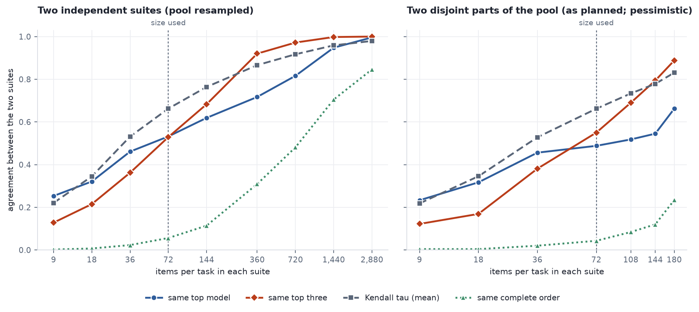

### 5.5 Caption wording (H2: failed; H3: supported by its rule, with a caveat)

*H2* predicted that the overall score would vary more across the three wordings than
across the five seeds for at least four of six models. It did for three. Averaged over
models the standard deviation was 1.44 points across wordings and 1.68 across seeds.
Wording did not matter more than regeneration.

*H3* had two parts and both held. The range of the overall score across wordings,
averaged over models, was 2.7 points (largest 4.4, for SigLIP), which exceeds the
1.85-point median gap between neighbouring models. And the wordings reorder the models:
Kendall tau between the rankings under two wordings was 0.14, 0.73 and 0.41 for the three
pairs. Under the second wording LAION-2B is first; under the others SigLIP is.

The caveat is that I cannot show these movements are caused by the wording. None of the
12 paired bootstrap intervals for a change in overall score excludes zero. Of 72 per-task
tests (six tasks, six models, two paraphrases; amendment A2), one has p < 0.05 before
correction, where chance predicts three or four, and none after. Between 43% and 53% of
items change outcome when the caption is reworded, but in tasks where a model is near
chance that is what coin flips do. On 432 items a wording effect of three points is
below what can be detected.

So the honest statement is narrower than H3 suggests. On one suite, changing the wording
reshuffles the ranking about as much as regenerating the items does, and both are within
sampling noise. A benchmark that reports one wording on one suite is reporting one draw
from that noise. Whether wording has a systematic effect on these models needs the
paraphrases on all five suites, which I did not run.

### 5.6 Floor and ceiling (H4: supported; H5: supported)

| Task | Chance | Weakest | Strongest | Models above chance | Pairs separated | KR-20 | Item-ability r | Verdict |
|---|---|---|---|---|---|---|---|---|
| object | 25 | 96.7 | 100.0 | 6 of 6 | 9 of 15 | 0.80 | 0.04 | ceiling |
| count | 25 | 35.0 | 52.2 | 6 of 6 | 10 of 15 | 0.90 | 0.18 | informative |
| binding | 50 | 49.2 | 55.3 | 0 of 6 | 1 of 15 | none | -0.01 | floor |
| spatial | 50 | 48.3 | 53.3 | 0 of 6 | 0 of 15 | none | 0.01 | floor |
| size | 50 | 51.1 | 57.5 | 3 of 6 | 2 of 15 | 0.40 | -0.03 | informative |
| digits | 25 | 58.3 | 96.9 | 6 of 6 | 11 of 15 | 0.99 | 0.46 | informative |

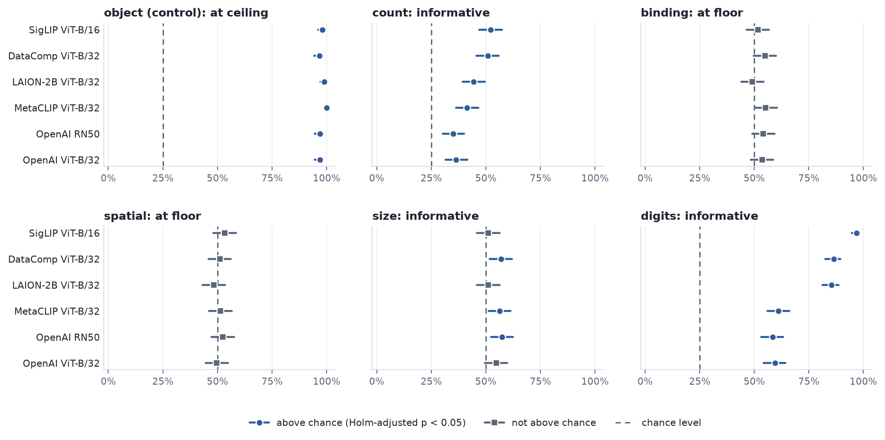

`binding` and `spatial` are at floor, as predicted: no model is above chance on 360
items. On level-1 `object` items every model scores at least 98.3%, and the whole task
is at ceiling. These three tasks produce numbers and carry no information about which
model is better. A negative KR-20 is shown as "none".

Two details. First, `object` still separates 9 of 15 pairs, because with 360 items the
difference between 96.7% and 100% is detectable. A task can be at ceiling and still
split hairs; the verdict is about whether the differences are worth having. Second,
`size` is "informative" by the rule but only just: three models are above chance and
the best scores 57.5%. I would not rely on it.

So the overall score, an average over six tasks, is three parts constant, one part weak
signal and two parts signal.

### 5.7 The difficulty knob (H8: partly supported)

| Task | Level 1 | Level 2 | Level 3 | Falls at each step |
|---|---|---|---|---|
| object | 99 | 98 | 96 | yes |
| count | 58 | 46 | 26 | yes |
| digits | 94 | 71 | 58 | yes |
| size | 55 | 53 | 56 | no |
| binding (floor) | 53 | 55 | 51 | not tested |
| spatial (floor) | 49 | 55 | 50 | not tested |

Accuracy averaged over models. In three of the four tasks that are not at floor the knob
works, and strongly for `count` and `digits`. At level 3 `count` is itself at floor
(21% to 33% across models): counting three to nine small shapes among distractors is
beyond all six. For `size` the knob does nothing, because the models are near chance at
every ratio.

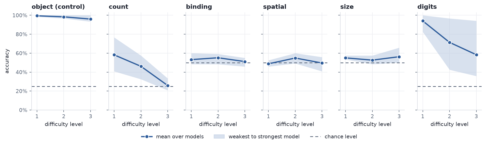

This is the part of a regenerable design that works as intended. When a task saturates,
as `object` has and as `digits` nearly has for SigLIP at level 1, the level can be
raised without writing new items by hand.

### 5.8 Items (H7: partly supported)

Of the 2,160 items, 103 are answered correctly by no model and 562 by every model (340
of those are `object` items). Together that is nearly a third of the suite that cannot
separate any pair.

H7 held for the floor tasks: the mean correlation between answering an item correctly and
overall ability is -0.01 for `binding` and 0.01 for `spatial`. It held for two of the
three informative tasks (`count` 0.18, `digits` 0.46) and failed for `size` (-0.03).

Flagging individual items is another matter. 322 items have an item-ability correlation
of -0.4 or below. That sounds like a list of bad items. But if the models that got each
item right were picked at random, 367 items would be flagged. Six examinees cannot
identify a bad item. What the comparison does show is where the signal is:

| Task | Flagged | Expected by chance |
|---|---|---|
| object | 7 | 5 |
| count | 47 | 76 |
| binding | 90 | 78 |
| spatial | 109 | 74 |
| size | 60 | 72 |
| digits | 9 | 63 |

`digits` has far fewer anti-correlated items than chance, because its items follow
ability. `spatial` has more. I do not think that marks bad items either. The null model
assumes models err independently, and models that share a bias, such as preferring one
phrase, will agree with each other on items where ability plays no part.

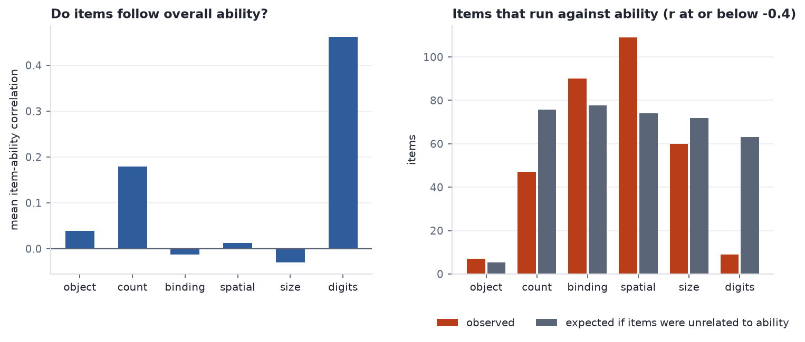

### 5.9 Redundancy between tasks

`count` and `digits` order the six models identically (Spearman 1.00, bootstrap interval
0.60 to 1.00). No other pair of tasks has an interval that excludes zero. Leaving any
one task out leaves the overall ranking unchanged (tau 1.00), except `digits`: without it
tau falls to 0.60 and DataComp replaces SigLIP at the top. The spread on `digits` is 39
points and on `count` 17, so the overall ranking is to a large extent a ranking of
how well these models read rendered numbers.

With six models a perfect rank correlation between two tasks is not strong evidence that
they measure one thing. It is a reason to look, with more models.

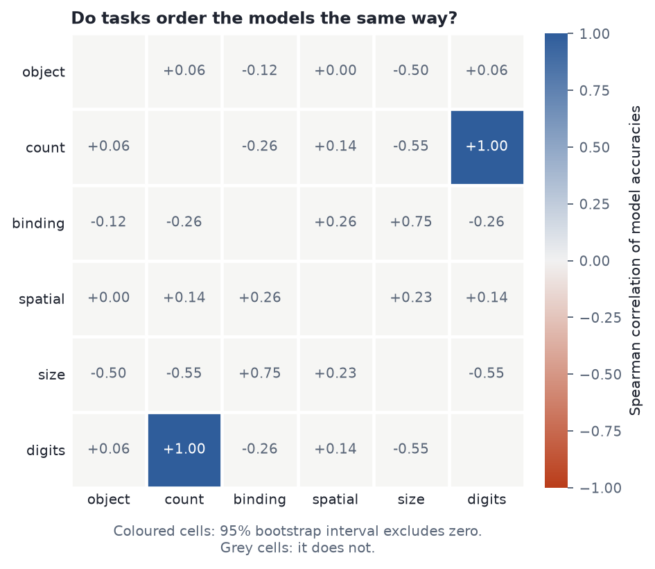

### 5.10 Audio (H9: supported)

| Model | Overall | 95% interval | bursts | pitch | order | tempo |
|---|---|---|---|---|---|---|
| CLAP larger, music and speech | 48.3 | 43.3 to 53.6 | 31 | 66 | 50 | 47 |
| CLAP larger, general | 47.8 | 42.8 to 52.5 | 37 | 58 | 51 | 46 |
| CLAP HTSAT unfused | 42.5 | 37.8 to 47.2 | 16 | 57 | 49 | 49 |

360 clips, 90 per task. Chance is 25% for `bursts` and 50% for the others.

`order` and `tempo` are at floor for all three models, as predicted. One model is above
chance on `pitch` (65.6%) and one on `bursts` (36.7%). CLAP HTSAT unfused scores 15.6% on
`bursts`, with a Wilson interval of 9.5% to 24.4%, which is below chance: it prefers a
wrong count systematically, and on the easiest clips it is right 3% of the time. A
model below chance has a bias, and a bias is information, but it is not the skill the
task was meant to measure.

Rewording matters more here than for images: the overall score of one model ranges over
17.5 points across the three wordings, and one of its paraphrase changes is the only one
in the study whose interval excludes zero. One of three model pairs is separated. With
three models and 90 clips per task the audio suite demonstrates that the generators, the
pipeline and the checks carry over to a second modality. It does not rank audio models.

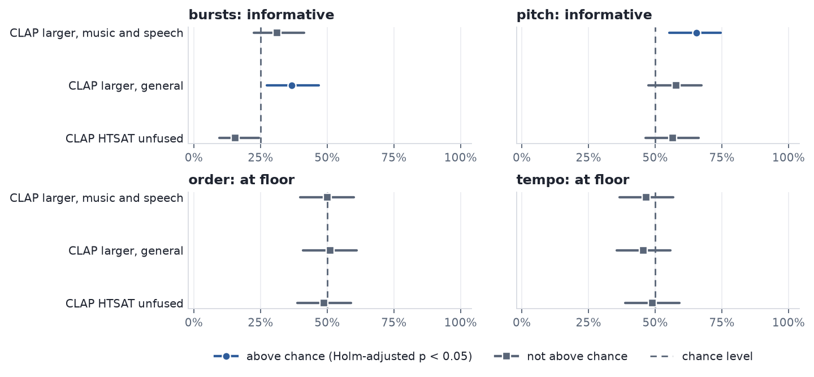

### 5.11 Scorecard

| | Prediction | Outcome |
|---|---|---|
| H1 | Regenerated suites agree: tau at least 0.70, same top model in four of five, scores consistent with sampling | Partly supported: tau 0.73 and consistent, but the top model changed (two suites against three) |
| H2 | Wording moves scores more than regeneration for at least four of six models | Failed: three of six |
| H3 | Wording range exceeds the median gap between neighbours, and reorders models | Supported: 2.7 against 1.85 points; but no wording effect could be told from noise |
| H4 | At least two image tasks at floor, `spatial` and `binding` | Supported |
| H5 | Level-1 `object` at ceiling for every model | Supported: lowest 98.3% |
| H6 | 72 items per task fix the top model (90%) and top three (80%); the complete order is not fixed at 180 | Partly supported: 49% and 55%; complete order 23% |
| H7 | Items follow ability in informative tasks and not in floor tasks | Partly supported: `size` does not |
| H8 | Accuracy falls with level in every task not at floor | Partly supported: three of four |
| H9 | At least two audio tasks at floor, `order` and `tempo` | Supported |

I was most confident about H4 and H5, and they held. I was wrong about how small a suite
could be (H6) and about wording dominating (H2).

### 5.12 What the health report says

`regenbench report` turns the seven checks into verdicts by fixed rules and writes one
HTML file ([docs/health_report.html](docs/health_report.html)). For the image suite it
gives two problems (suite size; floor and ceiling) and five cautions (ranking stability,
regeneration, wording, item quality, redundancy). That is a fair summary. The benchmark
is a sound generator attached to a suite that is too small and half dead.

## 6. Limits

- **What is being tested.** Zero-shot caption matching with contrastive models. These are
  not generative multimodal language models, and nothing here says how such models would
  score. The suite has a question-and-answer format for them, which I have not used.
- **Synthetic media.** Flat shapes on grey and pure tones are far from the photographs,
  captions and recordings these models were trained on. A model at chance on `spatial`
  here may do better on natural images, and the literature suggests not much better
  [2, 3], but this study cannot tell lack of skill from lack of familiarity.
- **Few models, of one size.** Six image models, four of them ViT-B/32, and three audio
  models. Item statistics, task correlations and KR-20 over six examinees are noisy, and
  I have tried to say so wherever they appear. Larger models may leave the floor.
- **Sample size.** 360 items per task give intervals of about five points on a task
  accuracy and cannot separate models closer than about two points overall. The audio
  suite, at 90 clips per task, is a demonstration.
- **Wording.** Three templates written by one person, on one of the five suites. That
  is too little to estimate a wording effect, and the paraphrases are mild.
- **The floor rule.** "No model above chance" depends on the sample size and on which
  models are present. `size` is on the edge of it.
- **Planning.** The plan was committed before any model was scored, but it was not
  registered externally and its author ran the experiments. Two analyses were added
  afterwards and one planned estimate was found to be biased; all three are marked as
  amendments.
- **Compute.** The run took 84 minutes against a budget of about 60.
- **Reproducibility.** Item generation is deterministic and checksummed. Rerunning one
  model on one suite on the same machine reproduced its scores bit for bit. Across
  machines and library versions floating-point arithmetic can differ, so an item with a
  near-tie between captions can flip. I have not measured how often.

## 7. What I would do next

1. Run a generative vision-language model through the question-and-answer format, and
   compare its ranking of tasks with the matching models'.
2. Drop or redesign the dead tasks. A benchmark should not average in tasks that are at
   floor for everything it tests; they belong in a separate diagnostic set, to be
   promoted when a model clears chance.
3. Use the item-level results to choose the suite size before the run, not after:
   generate until the pairs that matter are separated, which the pipeline's cache makes
   cheap.
4. Put all three wordings on every suite, with more models, to find out whether wording
   has a real effect.
5. Fit an item response model once there are enough models to support one, and use it
   to pick items adaptively.

## References

1. Radford, Kim, Hallacy, Ramesh, Goh, Agarwal, Sastry, Askell, Mishkin, Clark, Krueger,
   Sutskever. Learning Transferable Visual Models From Natural Language Supervision.
   ICML 2021.
2. Thrush, Jiang, Bartolo, Singh, Williams, Kiela, Ross. Winoground: Probing Vision and
   Language Models for Visio-Linguistic Compositionality. CVPR 2022.
3. Yuksekgonul, Bianchi, Kalluri, Jurafsky, Zou. When and Why Vision-Language Models
   Behave like Bags-of-Words, and What to Do About It? ICLR 2023.
4. Johnson, Hariharan, van der Maaten, Fei-Fei, Zitnick, Girshick. CLEVR: A Diagnostic
   Dataset for Compositional Language and Elementary Visual Reasoning. CVPR 2017.
5. Zhai, Mustafa, Kolesnikov, Beyer. Sigmoid Loss for Language Image Pre-Training.
   ICCV 2023.
6. Schuhmann et al. LAION-5B: An open large-scale dataset for training next generation
   image-text models. NeurIPS 2022.
7. Gadre et al. DataComp: In search of the next generation of multimodal datasets.
   NeurIPS 2023.
8. Xu, Xie, Tan, Huang, Howes, Sharma, Li, Ghosh, Zettlemoyer, Feichtenhofer.
   Demystifying CLIP Data. ICLR 2024.
9. Wu, Chen, Zhang, Hui, Berg-Kirkpatrick, Dubnov. Large-scale Contrastive
   Language-Audio Pretraining with Feature Fusion and Keyword-to-Caption Augmentation.
   ICASSP 2023.
10. Kuder, Richardson. The theory of the estimation of test reliability. Psychometrika,
    1937.
11. Wilson. Probable inference, the law of succession, and statistical inference.
    Journal of the American Statistical Association, 1927.
12. Efron. Bootstrap methods: another look at the jackknife. The Annals of Statistics,
    1979.
13. Kendall. A new measure of rank correlation. Biometrika, 1938.
14. Holm. A simple sequentially rejective multiple test procedure. Scandinavian Journal
    of Statistics, 1979.
15. McNemar. Note on the sampling error of the difference between correlated proportions
    or percentages. Psychometrika, 1947.
16. Recht, Roelofs, Schmidt, Shankar. Do ImageNet Classifiers Generalize to ImageNet?
    ICML 2019.
17. Card, Henderson, Khandelwal, Jia, Mahowald, Jurafsky. With Little Power Comes Great
    Responsibility. EMNLP 2020.
18. Rodriguez, Barrow, Hoyle, Lalor, Jia, Boyd-Graber. Evaluation Examples are not
    Equally Informative: How should that change NLP Leaderboards? ACL 2021.
19. Polo, Weber, Choshen, Sun, Xu, Yurochkin. tinyBenchmarks: evaluating LLMs with fewer
    examples. ICML 2024.
